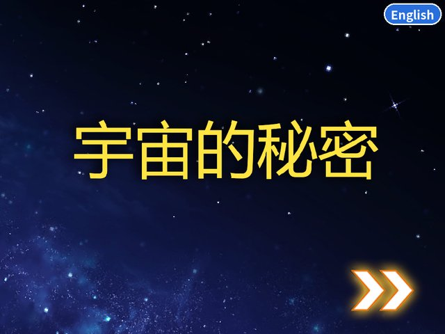
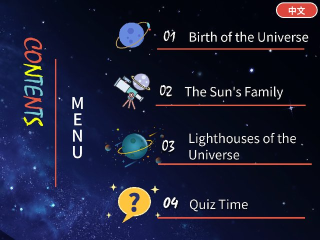

# 宇宙的秘密 · Secrets of the Universe

An interactive astronomy guide made in Scratch by Edison in 3rd grade, now with a quiz and a Chinese / English switch.

### [▶ Open it now in your browser](https://edisonli5656.github.io/Secrets-of-the-Universe/)
Works on computers, phones and tablets. Nothing to download.

  
  

## What's inside
- **01 Birth of the Universe** – the Big Bang and a clickable timeline of 12 periods, from the Planck epoch to the formation of the Solar System
- **02 The Sun's Family** – click the Sun and the eight planets to learn about each one
- **03 Lighthouses of the Universe** – neutron stars, pulsars and black holes
- **04 Quiz Time** – 10 questions to test what you learned

Use the button in the top-right corner to switch between 中文 and English.

## Files
- `index.html` – the project (runs in any browser; it is large, so the first load takes a few seconds)
- `secrets-of-the-universe.sb3` – the Scratch project, open it at scratch.mit.edu
